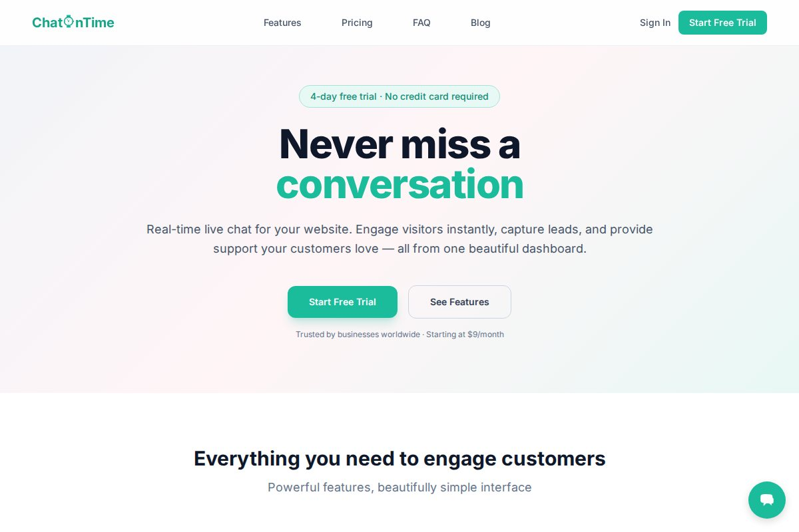
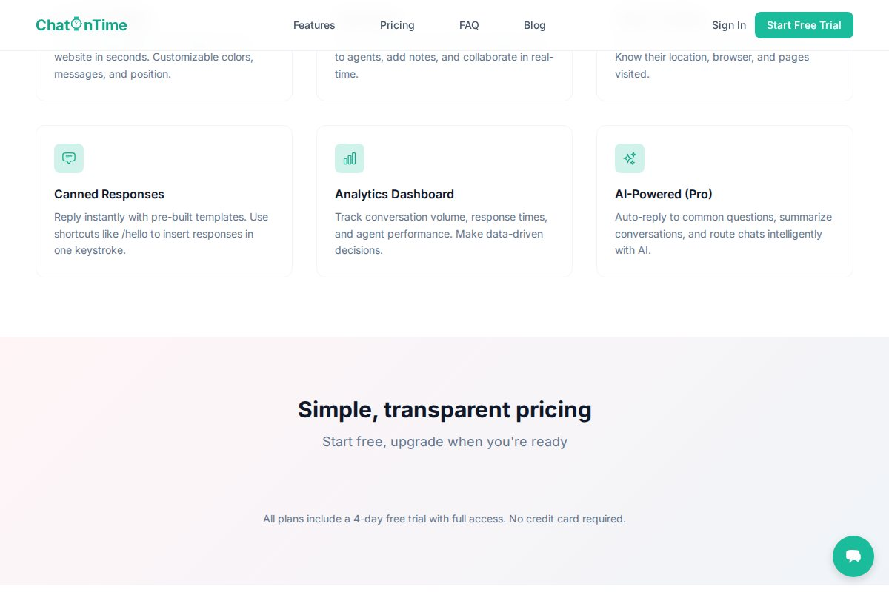
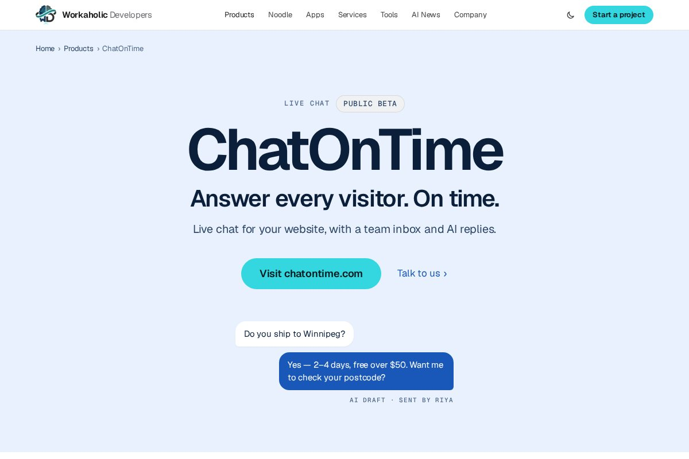

# ChatOnTime

**Live chat for your website, with a team inbox and AI replies.**

Status: Public beta

> This is a public showcase repository. It describes the product and links to it; the source code is private.

- Product site: https://chatontime.com
- Product page: https://workaholicdevelopers.com/products/chatontime

## What it is

ChatOnTime puts live chat on any website with one line of code. Visitors message you in real time; your team answers from a shared inbox with assignment, notes and canned replies, and AI can draft answers from your own knowledge base.

## Who it's for

Small and mid-sized businesses, online stores, SaaS companies and agencies.

## Features

- **One line to install.** A single script tag adds the chat widget, in your colours and position.
- **A shared team inbox.** Assign chats, leave notes and work together in real time.
- **See who is visiting.** Location, browser and the pages each visitor has seen.
- **Replies in a keystroke.** Canned responses with /shortcuts, and operating hours.
- **AI on your side.** Auto-replies, summaries and a knowledge base.

## Screenshots

*ChatOnTime features*

*ChatOnTime on workaholicdevelopers.com*

## Who builds it

Built and run by Workaholic Developers.

---

Built by [Workaholic Developers](https://workaholicdevelopers.com), a software company with teams in India and Canada. Questions or a project in mind: info@workaholicdevelopers.com
